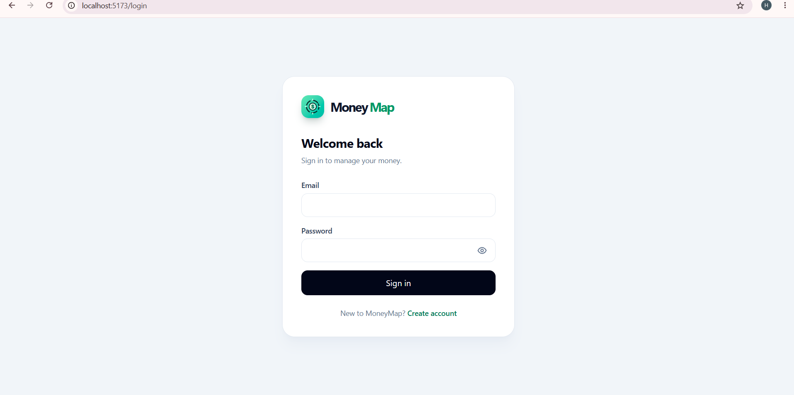
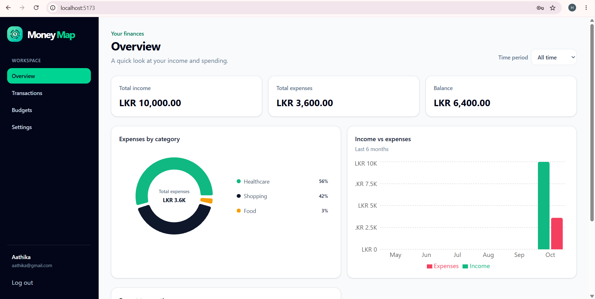
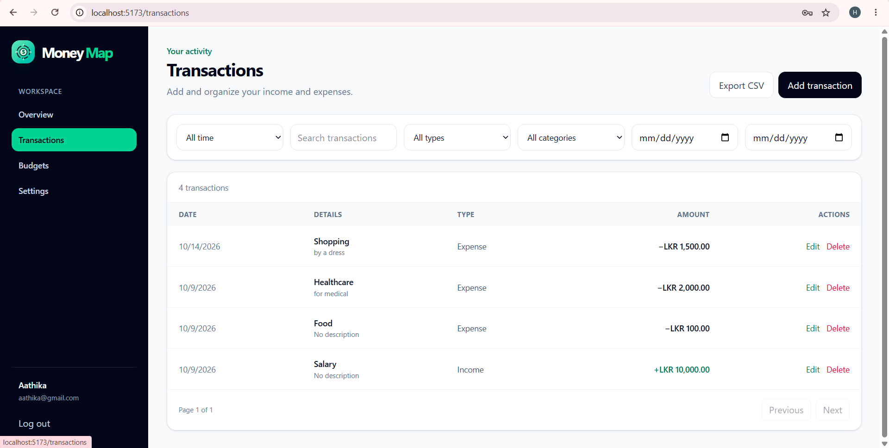
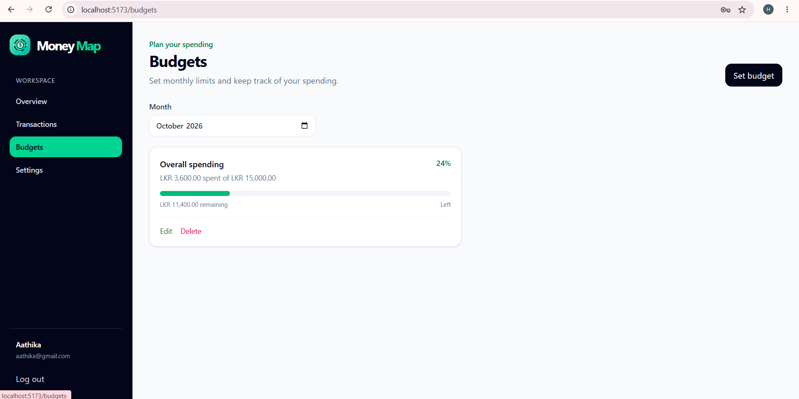

# MoneyMap — Expense & Budget Tracker

MoneyMap is a responsive personal finance app for recording transactions, setting monthly budgets, and understanding spending. It includes secure account authentication, dashboard reports, CSV export, and display preferences.

## Features

- Register and sign in with JWT authentication and bcrypt password hashing
- Create, edit, filter, and export income and expense transactions as CSV
- Set monthly or category budgets and track spending progress
- View dashboard totals, category spending, and six-month income/expense charts
- Choose currency, English/Sinhala/Tamil language, and light or dark mode
- Responsive pages with keyboard navigation and screen-reader support

## Tech stack

**Frontend:** React, Vite, Tailwind CSS, React Router, Axios, Recharts

**Backend:** Node.js, Express, MongoDB Atlas, Mongoose, JWT, bcryptjs, express-validator

## Project structure

```text
client/
  src/components/  Shared UI and forms
  src/context/     Authentication, theme, and date-period state
  src/i18n/        Language translations
  src/pages/       Dashboard, transactions, budgets, settings, login, register
server/
  config/          Database connection
  constants/       Supported currencies, languages, and categories
  controllers/     API request handlers
  middleware/      Authentication, validation, and error handling
  models/          Mongoose models
  routes/          Express API routes
Screenshots/       App screenshots used below
```

## Setup

Prerequisites: Node.js, npm, and a MongoDB Atlas cluster with a database user and an IP access-list entry for your machine.

1. Clone the repository and enter its folder:

   ```powershell
   git clone https://github.com/hathiffhaleem/expense-budget-tracker.git
   cd expense-budget-tracker
   ```

2. In a PowerShell window opened at the repository root, install backend dependencies and create `server/.env`:

   ```powershell
   cd server
   npm.cmd install
   notepad .env
   ```

   Add the server variables listed below in Notepad, then save and close it.

3. Start the backend in this PowerShell window:

   ```powershell
   npm.cmd run dev
   ```

4. Open a second PowerShell window at the repository root, install frontend dependencies, and start Vite:

   ```powershell
   cd client
   npm.cmd install
   npm.cmd run dev
   ```

   Open the local URL printed by Vite, usually `http://localhost:5173`.

### Environment variables

Create `server/.env` locally. Never commit it or share its secrets.

```env
PORT=5000
CLIENT_URL=http://localhost:5173
MONGODB_URI=mongodb+srv://<database-user>:<password>@<cluster-host>/<database-name>
JWT_SECRET=<long-random-secret>
JWT_EXPIRES_IN=7d
```

`MONGODB_URI` and `JWT_SECRET` are required. `PORT`, `CLIENT_URL`, and `JWT_EXPIRES_IN` are optional and use the shown defaults. If the database password contains reserved URL characters, URL-encode them in the URI.

The frontend optionally accepts `VITE_API_URL` in `client/.env`; by default it uses `http://localhost:5000/api`.

## API endpoints

All routes are under `/api`. Routes marked **Auth** require `Authorization: Bearer <token>`.

| Method | Endpoint | Purpose | Access |
| --- | --- | --- | --- |
| POST | `/auth/register` | Create an account | Public |
| POST | `/auth/login` | Sign in and receive a token | Public |
| GET | `/auth/me` | Get the signed-in user | Auth |
| PATCH | `/auth/me/currency` | Update display currency | Auth |
| PATCH | `/auth/me/language` | Update display language | Auth |
| PATCH | `/auth/me/password` | Change password | Auth |
| GET | `/transactions/categories?type=expense\|income` | List categories | Auth |
| GET | `/transactions` | List and filter transactions (`search`, `type`, `category`, `startDate`, `endDate`, `page`, `limit`) | Auth |
| POST | `/transactions` | Create a transaction | Auth |
| GET | `/transactions/:id` | Get a transaction | Auth |
| PATCH | `/transactions/:id` | Update a transaction | Auth |
| DELETE | `/transactions/:id` | Delete a transaction | Auth |
| GET | `/budget/progress?month=YYYY-MM` | Get budget progress for a month | Auth |
| GET | `/budget?month=YYYY-MM` | List budgets | Auth |
| POST | `/budget` | Create a budget | Auth |
| GET | `/budget/:id` | Get a budget | Auth |
| PATCH | `/budget/:id` | Update a budget | Auth |
| DELETE | `/budget/:id` | Delete a budget | Auth |
| GET | `/dashboard?startDate=YYYY-MM-DD&endDate=YYYY-MM-DD` | Get dashboard totals, categories, and monthly chart data | Auth |

Budget routes are also available under `/api/budgets`. Dashboard date parameters are optional, but must be provided together when used.

## Screenshots

| Login | Dashboard |
| --- | --- |
|  |  |

| Transactions | Budgets |
| --- | --- |
|  |  |
